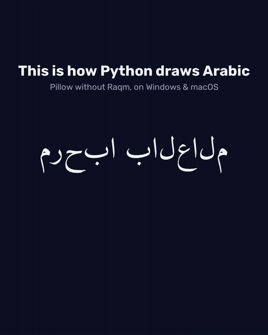
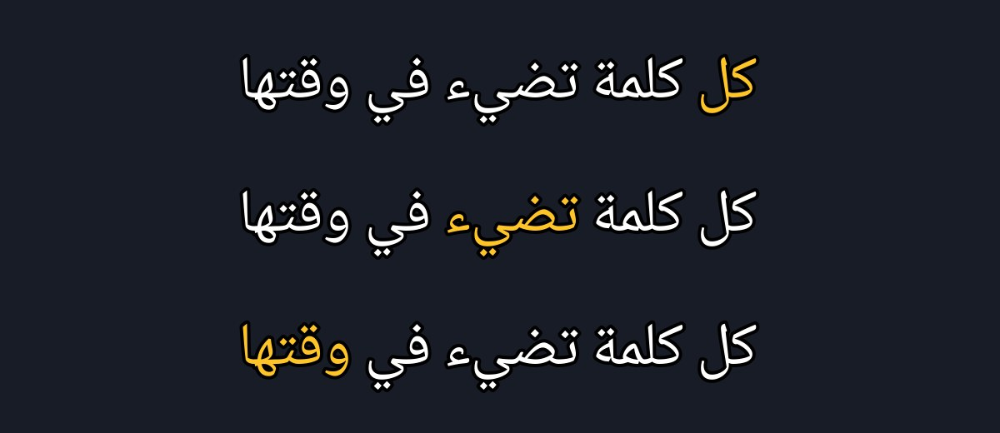
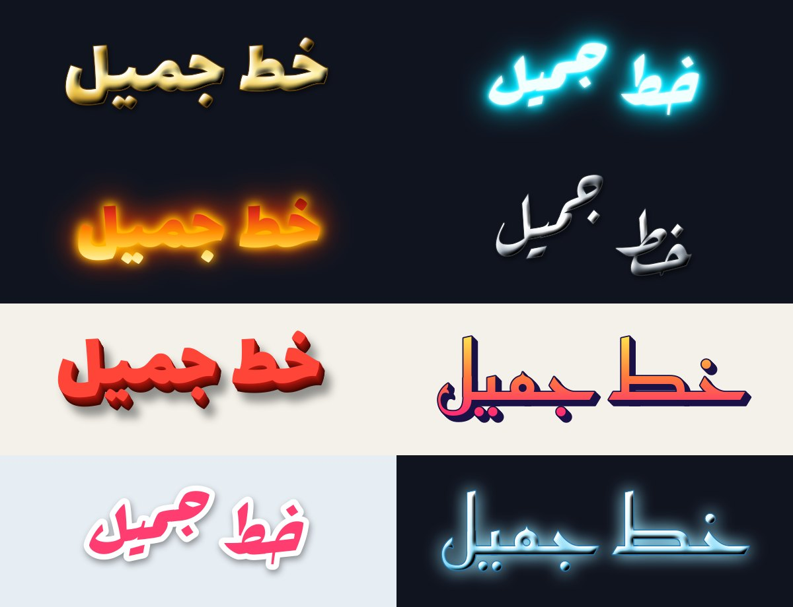
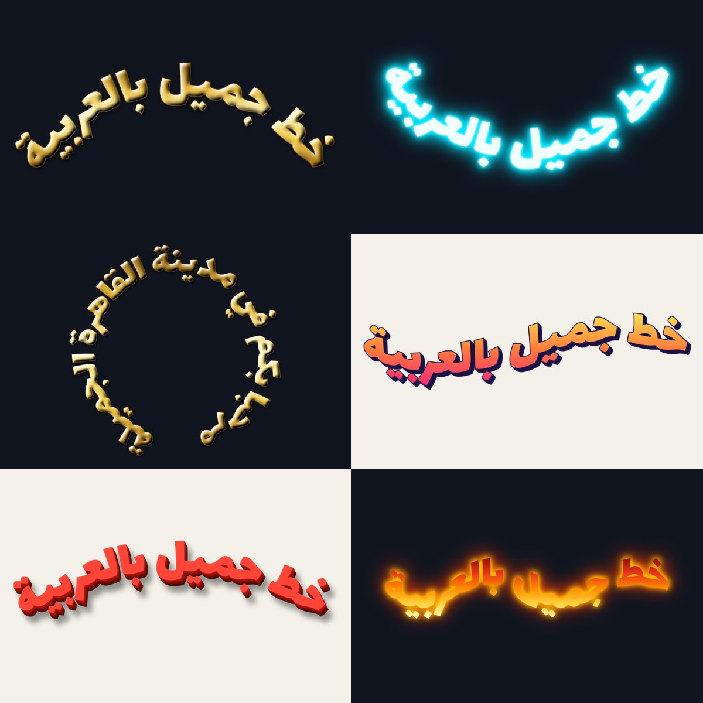
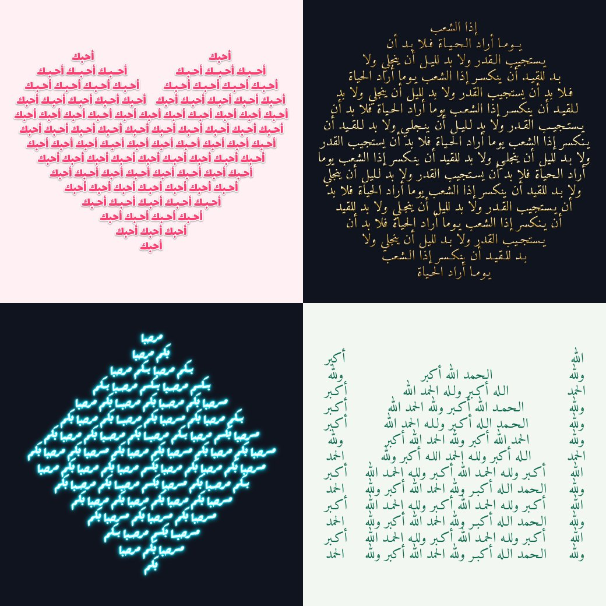
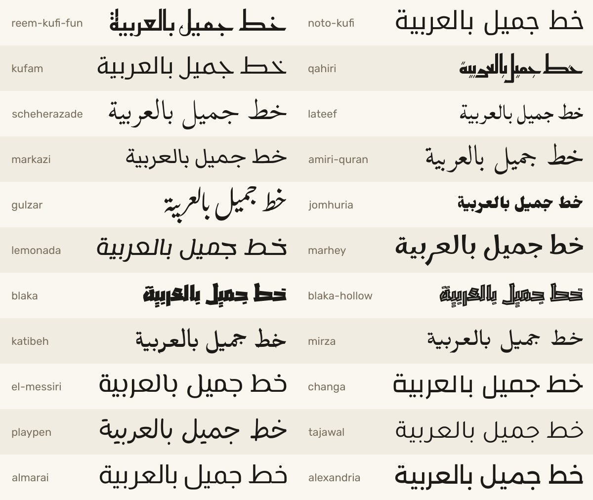

# Khatt (خَطّ)

[](https://pypi.org/project/khatt/)
[](https://github.com/DrEssam97/khatt/actions/workflows/ci.yml)
[](LICENSE)
[](pyproject.toml)
[](khatt/fonts/LICENSES/)
[](https://pepy.tech/projects/khatt)

**Correct Arabic text for Python: on images, in videos and in the terminal.**
Joined letters, right-to-left order and vowel marks in place, the same on Windows,
macOS and Linux, with no system libraries.

<p align="center">
  
</p>

Try it without installing anything:

```bash
uvx khatt "مرحبا"
```

Or [install it](#install) with `pip install khatt`.

**Used by**

- [MoneyPrinterTurbo](https://github.com/harry0703/MoneyPrinterTurbo) for Arabic subtitles in the videos it generates
- [supervision](https://github.com/roboflow/supervision) for Arabic labels in `RichLabelAnnotator` (optional `rtl` extra)
- [RapidOCR](https://github.com/RapidAI/RapidOCR) for Arabic text in its result images (optional `rtl` extra)
- [ComfyUI LayerStyle](https://github.com/chflame163/ComfyUI_LayerStyle) for Arabic in its Simple Text Image node
- [manga-image-translator](https://github.com/zyddnys/manga-image-translator) for Arabic in the translations it draws onto manga pages

## Features

- **Draw on images.** `khatt.draw_text` is a drop-in for Pillow's `ImageDraw.text`, with
  wrapping, alignment, outlines and translucent fills. `khatt.overlay` fits text into a
  box and `khatt.text_bbox` measures it.
- **Coloured words.** `spans` colours part of the text, such as the word being spoken in a
  caption, without breaking a single join.
- **OpenCV and receipts.** `khatt.put_text` draws onto NumPy frames like `cv2.putText`,
  and `khatt.receipt_image` lays out receipts for thermal printers.
- **Word art.** Gold, neon, fire, 3D and more in one line with `khatt.word_art`, or build
  your own from gradients, glows, shadows, depth and bevels.
- **Calligrams.** `khatt.calligram` flows text inside a heart, a circle or any image of
  your own, with Arabic lines stretched by kashida.
- **Zakhrafa.** `khatt.zakhrafa` decorates names to copy and paste, without breaking a
  single join.
- **SVG.** `khatt.render_svg` gives the same text as vector outlines, for the web, design
  tools and cutting machines.
- **Video captions.** `khatt.video.TextClip` is a drop-in for moviepy's `TextClip`, and
  `khatt.video.word_captions` lights up each word as it's said, from Whisper's word
  timings.
- **Terminal art.** Render Arabic as `blocks`, `ascii` or `braille` art, the Arabic
  FIGlet, from Python or the `khatt` command.
- **Any font.** Eight bundled OFL fonts in Naskh, Kufi, Ruqaa and display styles, 22 more
  with `pip install khatt-fonts`, or your own `.ttf`/`.otf`, with fallback fonts for
  characters it has no glyph for.
- **The same output everywhere.** khatt shapes and draws text itself with HarfBuzz, so
  it doesn't depend on Raqm, FriBiDi or any other system library, and it never shapes
  text twice. `khatt --doctor` shows what your environment has, and
  finds code that still pre-shapes Arabic with arabic_reshaper.

## Install

```bash
pip install khatt            # or: uv add khatt
pip install "khatt[video]"   # adds moviepy, for khatt.video captions
```

khatt supports Python 3.10 to 3.13 on Windows, macOS and Linux.

From source:

```bash
git clone https://github.com/DrEssam97/khatt.git && cd khatt
uv sync
```

## Drawing on images

`khatt.draw_text` draws correctly shaped Arabic, mixed Arabic/Latin and Arabizi
onto an existing Pillow image. It's a drop-in for `ImageDraw.text`, and
`khatt.overlay` fits text into a box:

```python
from PIL import Image
import khatt

image = Image.open("certificate.png").convert("RGBA")

# Like ImageDraw.text: xy is where the anchor goes ("ra" = right edge, ascender line).
khatt.draw_text(image, (1100, 80), "شهادة تقدير", size_px=72, anchor="ra", fill="#1a3c6e")
khatt.draw_text(image, (1100, 200), "تُمنح هذه الشهادة إلى", size_px=36, anchor="ra",
                max_width=800)  # wraps at spaces

# The largest size at which the name fits the box, wrapped if it has to be.
khatt.overlay(image, "محمد عبد الله", (200, 260, 1100, 400), padding=12, fill="black")

image.save("certificate-filled.png")

# Outlined text, e.g. captions or thumbnails over busy backgrounds.
frame = Image.open("frame.png").convert("RGB")
khatt.draw_text(frame, (640, 650), "مرحبا بالعالم", size_px=64, anchor="md",
                fill="white", stroke_width=5, stroke_fill="black")

# Measure without drawing, like ImageDraw.textbbox: the exact box draw_text paints.
left, top, right, bottom = khatt.text_bbox("مرحبا بالعالم", xy=(640, 650), size_px=64,
                                           anchor="md", stroke_width=5)
```

- Pass text as typed. Don't run it through `arabic_reshaper` or `get_display` first.
- `draw_text`: `size_px` (pixels per em, like `ImageFont.truetype`), `fill`
  (colour name, `#rrggbb[aa]` or an RGB/RGBA tuple; alpha makes the text
  translucent), Pillow-style `anchor` (`l`/`m`/`r` + `a`/`t`/`m`/`s`/`b`/`d`),
  `max_width` in pixels to wrap, `line_spacing` (baseline distance in multiples of
  the size) or `spacing` (pixels between lines, as in Pillow's `multiline_text`),
  `align` (`None`: right-to-left paragraphs right-aligned, left-to-right
  ones left-aligned), `keep_tashkeel` (diacritics are kept by default on images),
  and `stroke_width` / `stroke_fill` for an outline, as in Pillow: it grows
  outward around the text without moving it, and `stroke_fill` defaults to
  `fill`.
- `overlay(image, text, (left, top, right, bottom))`: `fit="shrink"` (default) uses
  the largest size between `max_size_px` and `min_size_px` at which the wrapped
  text fits; `"wrap"` wraps at `max_size_px`; `"none"` draws at `max_size_px` as
  is. Also `align`, `valign` (`top`/`middle`/`bottom`), `padding`, and the same
  `stroke_width` / `stroke_fill` (the outline is fitted inside the padding too).
  It never draws outside the box: text that doesn't fit is clipped, with a
  `khatt.TextOverflowWarning`.
- `text_bbox(text, xy=(0, 0), ...)` takes `draw_text`'s arguments and returns
  `(left, top, right, bottom)`: exactly the pixels `draw_text` would paint, outline
  included. Use it to measure words for your own wrapping or to size a box behind
  a caption.
- RGB and RGBA images both work; on RGBA, a transparent background stays
  transparent around the text.

### Colour part of the text

`spans` draws parts of the text in their own colour, for example the word being spoken
in a karaoke caption. The line is still shaped as one, so letters keep their joins where
the colour changes, and the layout is exactly the same as without spans.

```python
text = "كل كلمة تضيء في وقتها"
start = text.index("تضيء")
khatt.draw_text(frame, (640, 650), text, size_px=64, anchor="md", fill="white",
                stroke_width=4, stroke_fill="black",
                spans=[(start, start + len("تضيء"), "gold")])
```



- A span is `(start, end, fill)` or `khatt.Span(start, end, fill)`: positions in the
  text as you pass it, so `text[start:end]` is the part, and any colour `fill` takes.
  Where spans overlap, the later one wins.
- `khatt.caption_image` takes `spans` too.

**Why not just `ImageDraw.text`?** Pillow shapes Arabic only when it's built with
Raqm, which most Windows installs aren't. The usual workaround,
`arabic_reshaper` plus `get_display`, pre-shapes the text, so wherever native
shaping *is* available (Pillow with Raqm, matplotlib 3.11+) the text gets shaped
twice and comes out corrupted. khatt never hands text to another shaper: it
shapes and rasterizes with HarfBuzz and composites only the finished pixels, so
the output is identical everywhere.

`khatt --doctor` (API: `khatt.doctor()`) shows which shapers your environment
has and warns about that double-shaping trap:

```text
$ khatt --doctor
khatt 0.9.0 (Python 3.13.15)
Pillow 12.3.0: no Raqm, so ImageDraw.text cannot shape Arabic
matplotlib: not installed
arabic_reshaper: not installed
khatt shapes text itself: its output is the same in every case above.
```

Give it your project, `khatt --doctor src/`, and it also lists every place that still
pre-shapes Arabic with arabic_reshaper or `get_display`. Strings that were already
reshaped can be turned back with `khatt.unreshape(text)`. See
[Moving off arabic_reshaper](docs/arabic-reshaper.md).

### OpenCV and NumPy arrays

`cv2.putText` has no Arabic letters. `khatt.put_text` takes the same order of arguments
and BGR colours, and draws into the frame in place:

```python
import cv2
import khatt

frame = cv2.imread("frame.png")
khatt.put_text(frame, "مرحبا بالعالم", (40, 80), size_px=48, color=(0, 255, 255))
```

`org` is the left end of the baseline, as in OpenCV. Grayscale and BGRA frames work
too, `channels="rgb"` takes RGB arrays, and only the part under the text is touched.
NumPy is only needed when you call it. [More recipes](docs/recipes.md): pygame,
Dear PyGui, Tkinter and Streamlit.

### Receipts for thermal printers

ESC/POS printers have no Arabic fonts, so receipts print as images. `khatt.receipt_image`
lays one out at the printer's width, in black and white:

```python
from escpos.printer import Usb
import khatt

receipt = khatt.receipt_image(
    [("قهوة عربية", "15.00"), ("كعكة", "12.50"), "---", ("المجموع", "27.50")],
    title="مقهى الخط",
    footer="شكرا لزيارتكم",
)
Usb(0x04B8, 0x0202).image(receipt)
```

- A row is a line of text, or a `(start, end)` pair: the item on the receipt's starting
  side (the right, for Arabic) and the price on the other. A long item wraps without
  running into its price; `"---"` draws a dividing line and `""` a blank one.
- `width` is `"80mm"` (576 dots, the default), `"58mm"` (384) or a number of dots. Also
  `font` (default `noto-naskh`), `size_px`, `title_size_px`, `line_spacing`, `margin`,
  `direction` and `threshold`.

## Word art



```python
import khatt

# A finished image, as big as the art, on a transparent background.
khatt.word_art("خط جميل", effect="gold", size_px=200).save("gold.png")

# Any font works. Heavy ones show effects best, so word_art starts with lalezar.
khatt.word_art("خط جميل", effect="neon", font="rakkas").save("neon.png")

# Or straight onto your own image: draw_text and overlay both take an effect.
khatt.overlay(poster, "عرض خاص", (60, 40, 1140, 300), font="lalezar", effect="fire")
```

```bash
khatt "خط جميل" --effect gold -o gold.png
```

The presets are `3d`, `fire`, `gold`, `ice`, `neon`, `retro`, `silver` and `sticker`.
`khatt.list_effects()` lists them.

Effects work on the finished text, never on single letters, so Arabic stays joined and
tashkeel stays in place. To make your own, combine the parts. Lengths are fractions of
the font size, so an effect looks the same at any size:

```python
style = khatt.Effect(
    fill=khatt.Gradient(["#ffe14d", "#ff2975"]),    # or any colour; angle=0 runs left to right
    outline=0.02, outline_fill="navy",
    shadow=khatt.Shadow(offset=(0.05, 0.06), blur=0.03),
    glows=khatt.Glow(radius=0.12, color="#ff2975"),  # one glow, or several
    extrude=khatt.Extrude(depth=0.1, angle=45, color="#333"),
    bevel=0.03,
)
khatt.draw_text(image, (40, 40), "خط", size_px=120, effect=style)
```

Presets are plain `Effect` objects, so a variation is one line:
`dataclasses.replace(khatt.get_effect("3d"), fill="#2563eb")`.

### Text on curves



```python
khatt.word_art("خط جميل", effect="gold", curve="arc").save("arc.png")
khatt.word_art("مرحبا بكم في القاهرة", effect="neon", curve="ring").save("ring.png")

# Make your own: how much of a circle, or how tall and how many waves.
khatt.word_art("خط جميل", curve=khatt.Arc(angle=200))
khatt.word_art("خط جميل", curve=khatt.Wave(height=0.3, waves=2))
```

```bash
khatt "خط جميل" --effect fire --curve wave -o wave.png
```

The presets are `arc`, `smile`, `ring` and `wave`. Placing letters one by one along a
curve is what breaks Arabic, because rotated neighbours stop meeting. khatt bends the
whole line as one sheet instead, so joins and tashkeel move with it. Text that is too
short for a tight curve raises a `ValueError`, because its letters would meet in the
middle; use a smaller angle or longer text.

## Calligrams: text inside a shape



```python
khatt.calligram("أحبك", shape="heart", effect="sticker", font="lalezar").save("heart.png")

# Your own shape: any image, whose dark or opaque pixels are the inside.
from PIL import Image
khatt.calligram("الله أكبر ولله الحمد", shape=Image.open("mosque.png")).save("mosque.png")
```

```bash
khatt "أحبك" --shape heart -o heart.png
khatt "إذا الشعب يوما أراد الحياة" --shape circle --no-repeat -o circle.png
```

The presets are `arch` (a pointed arch, as in a mihrab), `circle`, `crescent`, `diamond`
and `heart`. Lines run from the
top of the shape to the bottom, each as wide as the shape at that height, and never cut
a letter at the edge. The text repeats until the shape is full; `repeat=False` fits it
in once, as big as it goes. Arabic lines are stretched to their full width with kashida
(`ـ`), the way a calligrapher would, rather than with wider gaps, and never inside
lam-alef. A line that would have to grow by more than 30% is centred instead.

Shapes show best with several words a line, so parts thinner than a line of text, like
the points of a star, stay empty unless the text is small: pass `size_px` to choose.

## SVG: vector outlines

```python
svg = khatt.render_svg("خط جميل", font="lalezar", size_px=120, fill="#0b5394")
Path("khatt.svg").write_text(svg, encoding="utf-8")
```

```bash
khatt "خط جميل" --font lalezar -o khatt.svg
```

The same shaping and layout as images, with each glyph's outline taken from the font, so
the SVG matches `draw_text` and stays sharp at any size: for the web, design tools,
printing, laser cutters and vinyl cutters. It takes `draw_text`'s options (`fill`,
`align`, `max_width`, `line_spacing`, `spacing`, outlines with `stroke_width`,
`fallback_fonts`) plus `padding` and `background`. Each glyph is its own path, so where
Arabic letters join, their outlines overlap: for a cutting machine, weld them first
(Cricut Design Space: Weld). Effects, curves and calligrams are images only for now.

## Zakhrafa: decorated names

```python
khatt.zakhrafa("محمد")             # مـحـمـد
khatt.zakhrafa("محمد", "long")     # مـــحـــمـــد
khatt.zakhrafa("محمد", "royal")    # ꧁༺ مـ͜͡ـحـ͜͡ـمـ͜͡ـد ༻꧂
khatt.zakhrafa("نور الهدى", "hearts")
```

```bash
khatt "محمد" --zakhrafa all
```

Decorated text to copy and paste, for display names and bios. The styles are
`brackets`, `crown`, `dots`, `flowers`, `hearts`, `long`, `royal`, `stars`, `tatweel` and
`waves` (`khatt.list_zakhrafa()`). Unlike most zakhrafa sites, khatt only decorates where
letters join, and never inside lam-alef, so the words stay joined and readable, and
tashkeel stays with its letter. The `tatweel` and `long` styles also draw with
`word_art`, for a stretched name in gold or neon.

Screen readers and search engines struggle with decorated text, so keep it for names,
not for text people need to find or hear.

## Video captions (moviepy)

`khatt.video.TextClip` is a drop-in for moviepy's `TextClip`: same arguments,
same order, same clip sizes, but the text is shaped by khatt. moviepy's own
`TextClip` draws with Pillow, so on Windows (no Raqm) Arabic comes out as
disconnected letters in reverse order, and with Pillow 11 or later it cuts off
the bottom of label clips (descenders, kasra, tanween), English included.

```python
from moviepy import ColorClip, CompositeVideoClip
from khatt.video import TextClip  # instead of: from moviepy import TextClip

caption = TextClip(
    text="بِسْمِ اللَّهِ الرَّحْمَٰنِ الرَّحِيمِ",
    font_size=56, color="white", stroke_color="black", stroke_width=3,
    method="caption", size=(1000, None),  # wraps to 1000 px
).with_duration(3).with_position(("center", "bottom"))
video = CompositeVideoClip([ColorClip((1280, 720), (20, 30, 60), duration=3), caption])
video.write_videofile("caption.mp4", fps=24)
```

- Every moviepy 2.2 argument works: `font_size`, `size`, `margin`, `color`,
  `bg_color`, `stroke_color`, `stroke_width`, `method` (`"label"` or
  `"caption"`, with the automatic font size), `text_align`,
  `horizontal_align`, `vertical_align`, `interline`, `transparent`,
  `duration`, `filename`.
- Differences: `font` takes a bundled name or a font path and defaults to
  Amiri; `text_align` defaults to aligning each paragraph by its direction
  (Arabic right, English left) instead of `"left"`; `filename` is read as
  UTF-8; `keep_tashkeel=False` strips diacritics.
- Clips are as tall as moviepy's formula says (ascent + descent + outline,
  plus `interline` spacing per line), and taller only if stacked diacritics
  reach beyond it, so nothing is cut off. The exception: words aren't broken,
  so if you fix both `size` and `font_size` and a word is wider than the
  width, the edges are cut and you get a `khatt.TextOverflowWarning`.
- Without moviepy, `khatt.caption_image(text, ...)` takes the same arguments
  and returns the frame as a Pillow image, e.g. for ffmpeg overlays.

### Word-timed captions

`word_captions` turns word timings into captions where each word lights up as it's
said. The highlighted word is drawn with `spans`, so its letters stay joined to the
rest of the line.

```python
import whisper  # or faster-whisper, whisperX, stable-ts
from moviepy import CompositeVideoClip, VideoFileClip
import khatt
from khatt.video import word_captions

video = VideoFileClip("talk.mp4")
result = whisper.load_model("small").transcribe("talk.mp4", word_timestamps=True)
words = khatt.words_from_whisper(result)

captions = word_captions(words, video.size, highlight_color="gold")
CompositeVideoClip([video, captions]).write_videofile("talk-captioned.mp4")
```


- `khatt.words_from_whisper` reads the results of openai-whisper, faster-whisper,
  whisperX and stable-ts, with word timestamps on. Or build the list yourself:
  `khatt.Word("مرحبا", start=0.0, end=0.4)`, in seconds.
- Lines break at `max_chars` (42), after a pause longer than `max_gap` seconds (1.0) or
  at the end of a sentence. A line stays up `hold` seconds (0.5) after its last word.
- `highlight="spoken"` keeps the words already said lit, instead of only the current
  one. Also `font`, `font_size`, `color`, `highlight_color`, `stroke_color`,
  `stroke_width`, `bg_color` and `bottom` (the space below, as a fraction of the
  height).
- Without moviepy, `khatt.caption_steps(words)` gives each step's start, end, text and
  highlighted `spans`, ready for `khatt.caption_image(step.text, spans=...)`.

### Quran recitations

`quran_captions` lights up each word of a recitation, one verse at a time, from the free
word timings of Quran.com or Tarteel QUL. Each verse ends with its number in the verse
medallion, every mark stays, and the lines are spaced for the marks above and below
them.

```python
import json
from moviepy import VideoFileClip, CompositeVideoClip
import khatt
from khatt.video import quran_captions

# Word timings: Quran.com (chapter_recitations/{reciter}/{chapter}?segments=true)
# or a Tarteel QUL download. Text: the verses, in the edition the timings were made for.
timings = json.load(open("fatiha-timings.json", encoding="utf-8"))
verses = json.load(open("fatiha-verses.json", encoding="utf-8"))  # {"1:1": "بِسْمِ ...", ...}

video = VideoFileClip("fatiha.mp4")
words = khatt.words_from_quran(timings, verses)
CompositeVideoClip([video, quran_captions(words, video.size)]).write_videofile("out.mp4")
```

- The text comes from you and is drawn exactly as given: a `{"1:1": text}` mapping,
  word lists, or Quran.com's `verses` response with `words`. Words are counted as
  Quran.com counts them: a pause sign standing alone, such as `ۛ`, stays with the word
  before it, and a basmala that starts a surah's first verse (as in Tanzil's text) is
  shown before the verse. Editions still differ in a few places, so with Quran.com
  timings its own `verses` response is the surest text; you get a warning when a verse
  has more words than its timings cover.
- khatt shapes every one of the 6,236 verses of the Uthmani text exactly as HarfBuzz
  does, in Amiri (the default) and Noto Naskh Arabic, and in Amiri Quran and
  Scheherazade New from `pip install khatt-fonts`.
- `verse_numbers=False` leaves out the verse medallions. The other options are
  `word_captions`'s: `highlight="spoken"`, colours, `font_size`, `max_chars` (60, for
  long verses) and `hold` (1.5 seconds).

## Terminal art

khatt started as **the Arabic FIGlet that FIGlet can't be**: Arabic as Unicode art in the terminal.

```text
⠀⠀⠀⠀⠀⠀⠀⠀⠀⠀⢀⣾⡄
⠀⠀⠀⠀⠀⠀⠀⠀⠀⠀⢺⣿⣿⣄
⠀⠀⠀⠀⠀⠀⠀⠀⠀⠀⢸⣿⣿⠟
⠀⠀⠀⠀⠀⠀⠀⠀⠀⠀⠈⣿⣿
⠀⠀⠀⠀⠀⠀⠀⠀⠀⠀⠀⣿⣿
⠀⠀⠀⠀⠀⠀⠀⠀⠀⠀⠀⢻⣿⡆⠀⠀⠀⠀⠀⠀⠀⠀⠀⠀⠀⠀⠀⠀⠀⠀⠀⠀⠀⠀⠀⠀⠀⠀⠀⠀⠀⠀⣤⣄⡀
⠀⠀⠀⠀⠀⠀⠀⠀⠀⠀⠀⢸⣿⡇⠀⠀⠀⠀⠀⠀⠀⠀⠀⠀⠀⠀⠀⠀⠀⠀⠀⠀⠀⠀⠀⠀⠀⠀⠀⠀⢀⣾⣿⣿⣿⡗
⠀⠀⠀⠀⠀⠀⠀⠀⠀⠀⠀⢸⣿⡇⠀⠀⠀⠀⠀⠀⠀⠀⠀⠀⠀⠀⠀⠀⠀⠀⠀⠀⠀⠀⠀⠀⠀⠀⠀⠀⠈⠛⢿⣿⠟
⠀⠀⠀⠀⠀⠀⠀⠀⠀⠀⠀⠘⣿⣇⠀⠀⠀⠀⠀⠀⠀⠀⠀⠀⠀⠀⠀⠀⠀⠀⠀⠀⠀⠀⠀⠀⠀⠀⠀⠀⠀⠀⠀⠈
⠀⠀⠀⠀⠀⠀⠀⠀⠀⠀⠀⠀⣿⣿⠀⠀⠀⠀⠀⠀⠀⠀⣀⣠⣄⣀
⠀⠀⠀⠀⠀⠀⠀⠀⠀⠀⠀⠀⣿⡏⠀⠀⠀⠀⣀⣤⣶⣿⣿⣿⣿⣿⣷⡄⠀⠀⠀⠀⣠⣶⣿⣿⣷⣶⣤⣄⣀
⠀⠀⠀⠀⠀⠀⠀⠀⠀⠀⠀⠀⣿⠇⠀⣀⣴⣿⣿⣿⣿⣿⣿⣿⣿⣿⣿⣿⠀⠀⢠⣾⣿⣿⣿⣿⣿⣿⣿⣿⣿⣿⣶⣦⣤⣀⣀
⠀⠀⠀⠀⠀⠀⠀⠀⠀⠀⠀⠀⣿⣤⣾⣿⠟⠋⠉⠀⠀⠀⠀⠙⢿⣿⣿⡟⠀⠀⠘⠉⠉⠉⠉⠉⠉⠙⠛⠿⣿⣿⣿⣿⣿⣿⣿⣿⣿⣷⣶⣶⣶⣶⣶⡶
⠀⠀⠀⠀⠀⠀⠀⠀⠀⠀⢀⣴⣿⠟⠋⠀⠀⠀⠀⠀⠀⣀⣠⣤⣶⣿⡿⠁⠀⠀⠀⠀⠀⠀⠀⠀⠀⠀⠀⣀⣤⣽⣿⣿⣿⣿⣿⣿⣿⣿⣿⣿⣿⣿⡿⠁
⣀⣀⣀⣀⡀⠀⣀⣀⣀⣴⣿⣿⣥⣤⣤⣤⣴⣶⣶⣿⣿⣿⣿⣿⣿⣋⣀⡀⠀⠀⣀⣀⣀⣀⣤⣤⣶⣾⣿⣿⣿⡿⠿⠛⠋⠉⠁⠀⠀⠀⠀⠀⠀⠈
⠈⢿⣿⣿⣿⣿⣿⣿⣿⣿⣿⣿⣿⣿⣿⣿⣿⣿⣿⣿⣿⣿⣿⣿⣿⣿⣿⣿⣿⣿⣿⣿⣿⣿⣿⣿⡿⠟⠋⠉
⠀⠀⠙⠿⢿⣿⣿⣿⣿⣿⣿⣿⣿⠿⠿⠿⠿⠿⠛⠛⠉⠛⠛⠻⠿⠿⠿⠿⠿⠿⠿⠿⠟⠛⠉⠁
```

*(«خط», "khatt": line, script or calligraphy. Amiri font, `braille` style.)*

```text
                              -%+.
       :@.           =:       *+--  =@   *#                       =@
       -@.           +:        +=   =@   #%                       +@
   %+  -@.   =%   =**+***:     @#   =@   *%       -*****%+   -%.  +@
   @*  -@.   +@         +@.    %*   =@   *%      -@-    @*   -@.  +@
   @+  -@.   +@         .@-    %*   =@   *%      +@     @*   -@.  +@
   @+  -@.   +@         :@-    %#   =@   #%      :@-    @*   -@.  +@
   @*  :%****##**********%: +**%#***#%   +#       -*****%#**+*%   =%
  .@=        :-                                             :- -.
+*%+         -*                                             =+ *:
```

*(«ايه الأخبار», "What's the news?". Cairo font, `ascii` style.)*

### Python API

```python
import khatt

print(khatt.render("مرحبا"))                          # blocks style, size 10
print(khatt.render("خط", style="braille", size=16))   # bigger, high effective resolution
print(khatt.render("القاهرة", font="cairo", style="ascii", threshold=0.4))
print(khatt.render("السلام عليكم ورحمة الله", width=60))  # wraps at 60 columns
print(khatt.render("مرحبا\nKhatt 2026", font="rubik"))    # one art line per text line

art = khatt.render("مرحبا", style="braille")
khatt.art_to_image(art, fg="white", bg="#1e1e2e").save("art.png")  # the art as a picture

image = khatt.render_image("مرحبا\nKhatt 2026")  # the plain text: Pillow image, black on white
image.save("khatt.png")

khatt.list_fonts()   # ['amiri', 'cairo', 'noto-naskh', 'rubik']
khatt.list_styles()  # ['ascii', 'blocks', 'braille']
```

### CLI

```bash
khatt "مرحبا"                          # render to the terminal
khatt "خط" --style braille --size 16
khatt "القاهرة" -f cairo -s ascii -t 0.4
khatt "خط" -f ./MyFont.ttf             # any .ttf/.otf font file
echo "سلام" | khatt                    # stdin
printf 'سطر أول\nسطر ثاني' | khatt     # multi-line input
khatt "خط" --output art.txt            # save the art
khatt "خط" -s braille -o art.png       # save the art as an image
khatt "خط" -s ascii -o art.png --fg "#e5e5e5" --bg "#1e1e2e"   # terminal colours
khatt "خط" -o logo.png --bg none       # transparent background
khatt "خط" -o khatt.png --png text     # the plain high-resolution text instead
khatt --list-fonts
khatt --list-styles
khatt --doctor                         # which Arabic shapers are installed
```

Arabic diacritics (tashkeel) are stripped from text art by default, since they're
illegible at character-grid resolution. Pass `--keep-tashkeel` (API:
`render(..., keep_tashkeel=True)`) to render them. Plain-text images
(`--png text`, `render_image`) keep them by default, since they have the
resolution to show them: pass `--strip-tashkeel` (API:
`render_image(..., keep_tashkeel=False)`) to remove them.

In art images, braille dots and shade blocks are drawn as shapes, so they stay
crisp at any size; ascii characters are drawn in a bold sans font. Each
character gets a cell twice as tall as it is wide (12 × 24 px by default;
API: `cell_width=`), matching the terminal the art was sized for.

### Sizing and wrapping

Like FIGlet, letters have a fixed size and long text wraps:

- `size` (`--size`) is the font size in character rows per em (default 10). It
  gives the same on-screen height in every style; `braille` just packs 4× the
  dots into it.
- `width` (`--width`) is the maximum width. Lines wrap at spaces; a single
  word that can't fit on its own shrinks the whole render until it does. The
  CLI defaults to your terminal's width, the API to 80 columns; `width=None`
  turns wrapping off.
- Line breaks in the input start new lines. Right-to-left paragraphs are
  right-aligned, left-to-right ones left-aligned.
- `--fit` (API: `size=None`) is the 0.1.0 behaviour: scale each line to fill
  exactly `width` columns, without wrapping.

### Styles

| Style | Ramp | Notes |
|---|---|---|
| `blocks` | `░ ▒ ▓ █` | Default; reads well at any size |
| `ascii` | `. : - = + * # % @` | Pure ASCII, maximum compatibility |
| `braille` | `⠁ … ⣿` | 2×4 dots per cell, 8× the effective resolution |

### Why FIGlet can't do this

FIGlet fonts map **one character to one fixed glyph**. Arabic doesn't work that way:

- Every letter has up to four **positional forms** (isolated / initial / medial / final).
- Some letter pairs form **mandatory ligatures**: ل + ا must become لا.
- The script is **cursive**: letters connect, and the connections carry the word's shape.
- Text runs **right-to-left**, and real text mixes RTL words with LTR numbers and names.

khatt sidesteps glyph tables entirely with a **rasterize-then-map** pipeline:

```text
text ──► HarfBuzz shaping ──► HarfBuzz rasterization ──► density mapping ──► art
         (positional forms,    (real Arabic fonts,        (blocks / ascii /
          ligatures, bidi)      hi-res grayscale)          braille ramps)
```

The result is genuine calligraphic letterforms from real fonts, approximated in
terminal characters.

## Fonts

khatt bundles eight Arabic fonts:

| Font | Family | Character |
|---|---|---|
| `amiri` (default) | Amiri | Classical naskh, rich calligraphic detail |
| `aref-ruqaa` | Aref Ruqaa | Ruqaa, the everyday handwritten style |
| `cairo` | Cairo | Geometric, modern, bold strokes |
| `lalezar` | Lalezar | Heavy display letters, the default for word art |
| `noto-naskh` | Noto Naskh Arabic | Clean, highly legible naskh |
| `rakkas` | Rakkas | Bold, brushy display letters |
| `reem-kufi` | Reem Kufi | Modern Kufi, geometric and upright |
| `rubik` | Rubik | Strong Latin + Arabic pairing for mixed text |

A style name works as a font too: `naskh`, `ruqaa`, `kufi`, `display` and `modern`.

All fonts are licensed under the SIL Open Font License 1.1, preserved verbatim in
[`khatt/fonts/LICENSES/`](khatt/fonts/LICENSES/).

**More fonts.** `pip install khatt-fonts` adds 22 more open Arabic fonts in their own
package, so khatt itself stays small. khatt finds them on its own, and they are used by
name, like the bundled ones:



```python
khatt.word_art("خط جميل", effect="gold", font="jomhuria").save("gold.png")
khatt.draw_text(image, (40, 40), "مرحبا", font="gulzar")
```

| Style | Fonts |
|---|---|
| `kufi` | `reem-kufi-fun`, `noto-kufi`, `kufam`, `qahiri` |
| `naskh` | `scheherazade`, `lateef`, `markazi`, `amiri-quran` |
| `nastaliq` | `gulzar` |
| `display` | `jomhuria`, `lemonada`, `marhey`, `blaka`, `blaka-hollow`, `katibeh`, `mirza`, `el-messiri`, `changa` |
| `handwriting` | `playpen` |
| `modern` | `tajawal`, `almarai`, `alexandria` |

**Your own fonts.** Anywhere khatt takes a `font` (`render`, `render_image`,
`draw_text`, `overlay`, the CLI's `--font`), you can pass the path to a TrueType or
OpenType file instead of a bundled name, as a string or a `pathlib.Path`:

```python
khatt.draw_text(image, (40, 40), "مرحبا", font="brand/Tajawal-Bold.ttf")
```

```bash
khatt "مرحبا" --font ~/fonts/Tajawal-Bold.ttf
```

Bundled names take precedence over a file with the same name. Web fonts
(`.woff`/`.woff2`) aren't supported, so use the font's `.ttf` or `.otf` version. A
path that doesn't exist raises `KeyError` (like an unknown name), and a file that
isn't a usable font raises `ValueError`.

**Glyph coverage.** khatt skips characters a font has no glyph for, with a
`khatt.UnsupportedCharacterWarning`. `khatt.missing_characters(text, font)` lists
them beforehand, so you can fall back to another font:

```python
font = "brand/Tajawal-Bold.ttf"
if khatt.missing_characters(text, font):  # e.g. ["ے", "ٹ"]
    font = "amiri"  # also covers Persian and Urdu letters
```

Or keep your font and name fallbacks for what it can't draw. Every function that
takes a `font` also takes `fallback_fonts`, tried in order for each character the
font has no glyph for, such as Chinese inside an Arabic subtitle:

```python
khatt.draw_text(image, (40, 40), "مرحبا بالعالم 中文测试",
                font="fonts/NotoSansSC-Regular.ttf", fallback_fonts=["noto-naskh"])
```

Arabic stays joined within its own font, and line spacing follows `font`.

## Contributing

Bug reports, fixes and new features are welcome. See [CONTRIBUTING.md](CONTRIBUTING.md)
for the setup and checks, and open an [issue](https://github.com/DrEssam97/khatt/issues)
before starting on a larger change.

## License

khatt is released under the [MIT License](LICENSE). The bundled fonts are licensed
under the SIL Open Font License 1.1; see [NOTICE](NOTICE) and
[`khatt/fonts/LICENSES/`](khatt/fonts/LICENSES/).
